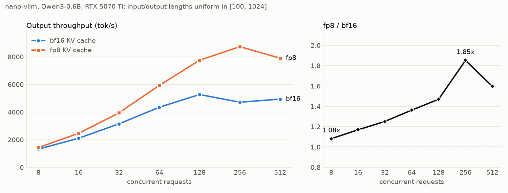

<p align="center">

</p>

<p align="center">
<a href="https://trendshift.io/repositories/15323" target="_blank"></a>
</p>

# Nano-vLLM

A lightweight vLLM implementation built from scratch.

> **This fork adds an FP8 KV cache**: `LLM(model, kv_cache_dtype="fp8")`.
> Profiling showed decode is bound by reading the KV cache (attention is 70-80% of a decode step, already at ~90% of
> DRAM bandwidth) and by its capacity (138 preemptions on `bench.py`). An e4m3 cache halves both problems.
>
> | RTX 5070 Ti, Qwen3-0.6B, `bench.py` workload | bf16 KV cache | fp8 KV cache |
> |---|---|---|
> | throughput (3 runs each, alternating) | 4698 tok/s | **8353 tok/s (1.78x)** |
> | KV cache capacity | 415 blocks (106k tokens) | 811 blocks (208k tokens) |
> | preemptions | 138 | 0 |
> | mean decode batch | 69 | 131 |
> | perplexity (teacher-forced, 16 x 1024 tokens) | 7.176 | 7.171 with calibrated per-layer scales (7.273 default) |
>
> 
>
> Design, measurements, correctness and quality analysis: [`docs/fp8_kv_cache.md`](docs/fp8_kv_cache.md).
> Profiling and benchmark scripts: [`perf/`](perf). Tests: `pytest` ([`tests/`](tests)).
> Needs `pip install flashinfer-python` (only for `kv_cache_dtype="fp8"`); the default `"auto"` is unchanged.

## Key Features

* 🚀 **Fast offline inference** - Comparable inference speeds to vLLM
* 📖 **Readable codebase** - Clean implementation in ~ 1,200 lines of Python code
* ⚡ **Optimization Suite** - Prefix caching, Tensor Parallelism, Torch compilation, CUDA graph, etc.

## Installation

```bash
pip install git+https://github.com/GeeeekExplorer/nano-vllm.git
```

## Model Download

To download the model weights manually, use the following command:
```bash
huggingface-cli download --resume-download Qwen/Qwen3-0.6B \
  --local-dir ~/huggingface/Qwen3-0.6B/ \
  --local-dir-use-symlinks False
```

## Quick Start

See `example.py` for usage. The API mirrors vLLM's interface with minor differences in the `LLM.generate` method:
```python
from nanovllm import LLM, SamplingParams
llm = LLM("/YOUR/MODEL/PATH", enforce_eager=True, tensor_parallel_size=1)
sampling_params = SamplingParams(temperature=0.6, max_tokens=256)
prompts = ["Hello, Nano-vLLM."]
outputs = llm.generate(prompts, sampling_params)
outputs[0]["text"]
```

## Benchmark

See `bench.py` for benchmark.

**Test Configuration:**
- Hardware: RTX 4070 Laptop (8GB)
- Model: Qwen3-0.6B
- Total Requests: 256 sequences
- Input Length: Randomly sampled between 100–1024 tokens
- Output Length: Randomly sampled between 100–1024 tokens

**Performance Results:**
| Inference Engine | Output Tokens | Time (s) | Throughput (tokens/s) |
|----------------|-------------|----------|-----------------------|
| vLLM           | 133,966     | 98.37    | 1361.84               |
| Nano-vLLM      | 133,966     | 93.41    | 1434.13               |


## Star History

[](https://www.star-history.com/#GeeeekExplorer/nano-vllm&Date)