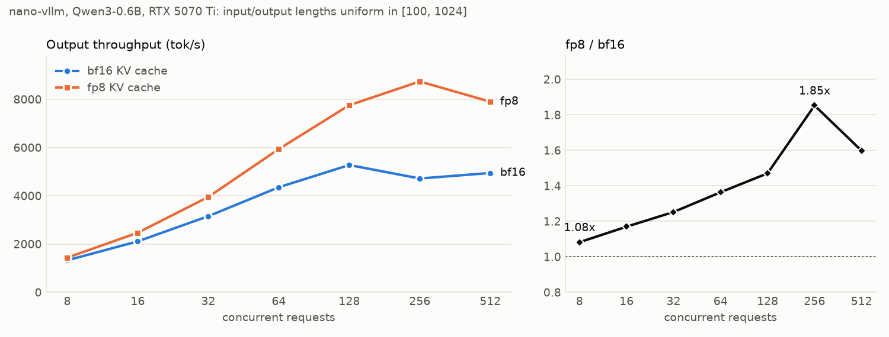

# FP8 KV cache for nano-vllm

`LLM(model, kv_cache_dtype="fp8")` stores the KV cache as `float8_e4m3fn`: half the bytes per token, so twice the
tokens fit in the same memory and decode attention reads half as much. On an RTX 5070 Ti with Qwen3-0.6B this is
**1.78x the throughput** of the bf16 cache on `bench.py`'s workload, with a mean NLL change of
**-0.0007** against bf16 when per-layer scales are calibrated (+0.0135 with the default global scales).

This document is the whole story: how the bottleneck was found, the design, how correctness and quality were
checked, the results, and what is left.

## 1. Finding the bottleneck

Measurements first ([`perf/BASELINE.md`](../perf/BASELINE.md): nano-vllm 4543 tok/s on `bench.py`, on par with a
tuned SGLang 0.5.22 on the same GPU).

**Where a step's time goes** ([`perf/profile_bench.py`](../perf/profile_bench.py), which wraps the engine's methods
with CPU timers and CUDA events; output in [`perf/results/profile_full.txt`](../perf/results/profile_full.txt)):

- 86% of the wall time is decode steps, and the GPU is busy 96.5% of it. The CPU-side work (scheduling, input
  preparation) is not the problem.
- The KV cache holds 415 blocks x 256 tokens; running all 256 requests at once would need 1206. The scheduler
  runs out of blocks constantly: **138 preemptions**, 30% of all prefill tokens are recomputation of preempted
  sequences, and the mean decode batch is 69 instead of 256.

**What a decode step costs** ([`perf/bench_decode.py`](../perf/bench_decode.py): the attention kernel per layer vs
a full decode step, on a synthetic batch; [`perf/results/bench_decode.txt`](../perf/results/bench_decode.txt)):

| batch | context | attention share of the step | attention bandwidth |
|---|---|---|---|
| 64 | 1024 | 73% | 792 GB/s |
| 128 | 1024 | 80% | 892 GB/s |
| 256 | 1024 | 82% | ~900 GB/s (some L2 hits) |

At the operating point of `bench.py` (batch ~90, context ~900) attention is 70-80% of a decode step, and
flash-attn already reads the cache at 85-93% of the 896 GB/s DRAM peak. A faster kernel cannot help much; reading
fewer bytes can. Both symptoms (memory capacity, memory bandwidth) point at the bytes per cached token.

Why not the other candidates: CUDA graphs are already used for decode; the CPU is idle-waiting 3% of the time; the
weights (1.2 GB) are read once per step and amortized over the batch, the KV cache (112 KiB per token) is not.

## 2. Design

### Storage: e4m3 with per-tensor scales

`cache = clamp(x / scale, -448, 448)` in `float8_e4m3fn` (1 sign, 4 exponent, 3 mantissa bits; max 448), and
`x ~= cache * scale` when reading. Two details matter:

- **Saturate, don't cast.** e4m3fn has no infinity: a PyTorch cast of a value past 448 gives NaN, which then
  spreads through softmax. Qwen3-0.6B's layer-0 keys reach |k| ~ 530. The store kernel (`store_kvcache_kernel` in
  [`nanovllm/layers/attention.py`](../nanovllm/layers/attention.py)) clamps after dividing by the scale. (Triton's
  fp32 -> e4m3 conversion turns out to saturate by itself; a mutation test that removes the clamp still passes.
  The clamp keeps the behavior from depending on that.)
- **Scales.** The default is one (k, v) pair for all layers, (2.0, 1.0), chosen so no layer's keys saturate.
  `kv_cache_scales` can also point to a JSON file with one pair per layer, written by
  [`perf/calibrate_kv_scales.py`](../perf/calibrate_kv_scales.py) from the largest |k|, |v| each layer stores on
  40 calibration texts (/ 448, x 1.25 margin). See section 4 for why per-layer scales matter.

The scales are Python floats: they become kernel arguments, so they are baked into the CUDA graphs at capture.

### Attention: FlashInfer, which reads fp8 directly

flash-attn 2 only reads fp16/bf16 caches. FlashInfer's paged attention takes an fp8 cache plus `k_scale`/`v_scale`
and dequantizes in registers, after the load, which is where the bandwidth is saved.

| attention | bf16 cache | fp8 cache |
|---|---|---|
| prefill, no cached prefix | flash-attn on this step's bf16 q/k/v | same (the cache is not read) |
| prefill reading cached prefix (prefix cache, chunked prefill) | flash-attn with `block_table` | FlashInfer `BatchPrefillWithPagedKVCacheWrapper` |
| decode | flash-attn `flash_attn_with_kvcache` | FlashInfer `BatchDecodeWithPagedKVCacheWrapper` (`use_tensor_cores=True`) |

nano-vllm's paged cache layout (`[num_blocks, block_size, kv_heads, head_dim]` per layer) is FlashInfer's "NHD"
layout, so no copy or conversion is needed. FlashInfer describes a batch in CSR form instead of a padded block
table: the block tables concatenated (`indices`), each sequence's offset into them (`indptr`), and the number of
tokens in each sequence's last block (`last_page_len`). `paged_kv_layout()` in
[`model_runner.py`](../nanovllm/engine/model_runner.py) builds it.

### CUDA graphs

A FlashInfer wrapper is *planned* on the CPU for a given batch (work partitioning, written into a workspace), then
*run* per layer. A captured CUDA graph bakes in the addresses of everything the kernel reads, so:

- **one wrapper per captured batch size**, created with `use_cuda_graph=True` and fixed `indptr`/`indices`/
  `last_page_len` buffers, captured on an all-padding plan;
- **re-plan right before every replay.** `plan()` rewrites the fixed buffers and the workspace in place, and the
  graph's kernels read the new plan;
- **padding:** a batch of 100 replays the graph for 112. The 12 dummy requests read 1 token of block 0, their
  K/V writes go to slot -1 (skipped by the store kernel), and their outputs are sliced off.
- **shared workspaces:** all wrappers (eager decode, prefill, 37 graphs) share one 128 MB float workspace and one
  8 MB int workspace (FlashInfer would allocate an int workspace per wrapper, ~300 MB total). This is safe because
  only one wrapper runs at a time and each is re-planned right before it runs.

The workspaces are allocated before the warmup run, so the KV cache sizing (which measures peak memory during
warmup) accounts for them.

### What does not change

`kv_cache_dtype="auto"` (the default) takes exactly the old code paths: outputs are bit-identical to upstream.

## 3. Correctness

`pytest` ([`tests/`](../tests)), on the engine's own code paths:

- `test_store_kvcache.py`: bf16 stores are exact; fp8 stores are bit-identical to a PyTorch reference
  (`(x / scale).clamp(-448, 448).to(float8_e4m3fn)`) for several scales; values past 448 saturate instead of NaN;
  padding slots (-1) are skipped.
- `test_fp8_attention.py`: the attention layer with FlashInfer against a float32 reference on the dequantized
  cache, for sequence lengths around block boundaries: eager decode; prefix-cache prefill (unaligned prefixes,
  chunks crossing blocks, sequences without a prefix in the same batch); and two CUDA graphs of different batch
  sizes that share a workspace, captured on padding and replayed alternately after re-planning with real batches.
- `test_engine.py` (slow, one engine process per config): fp8 has >= 1.9x the KV blocks; prefix-cache hits and
  chunked prefill go through the FlashInfer prefill path; greedy generations follow bf16; CUDA graphs match eager;
  teacher-forced quality bounds.

## 4. Quality

[`perf/eval_kv_quality.py`](../perf/eval_kv_quality.py): 16 texts x 1536 tokens, each prefilled in two chunks of
256 (the second reads the first from the cache), then fed one *true* token at a time through the decode path, with
CUDA graphs, as the engine runs. At every position: the NLL of the true next token and the argmax. Teacher forcing
keeps fp8 and bf16 on the same inputs, so differences don't compound the way free-running generation does.
Results: [`perf/results/quality_ablation.txt`](../perf/results/quality_ablation.txt).

| KV cache | mean NLL | ppl | NLL diff vs bf16 | argmax agreement |
|---|---|---|---|---|
| bf16 | 1.9707 | 7.176 | | |
| fp8, scales (1, 1) | 1.9830 | 7.265 | +0.0123 | 95.08% |
| fp8, scales (2, 1) (default) | 1.9842 | 7.273 | +0.0135 | 95.23% |
| fp8, per-layer calibrated | **1.9700** | **7.171** | **-0.0007** | 95.36% |

Two different effects:

- **A bias, fixed by per-layer scales.** Qwen3-0.6B's early layers store tiny values (layer 1: |v| <= 1.0,
  layers 0-7: |v| < 7). With one global v_scale of 1, most of them land below e4m3's smallest normal number
  (2^-6), where the relative precision drops sharply. Per-layer scales map each layer's range onto e4m3's normal
  range, and the systematic NLL increase disappears.
- **Noise, which stays.** With 3 mantissa bits every cached value carries up to ~6% relative rounding error. It
  averages out in the NLL, but flips the argmax on ~5% of positions: those where the top two tokens are nearly
  tied. Removing it needs more bits, not better scales.

The same eval also checked that the FlashInfer prefill path is equivalent to the first implementation
(dequantize the cached blocks into a temporary bf16 copy, then flash-attn): NLL 1.9843 vs 1.9842. That copy is
gone because it was not covered by the KV cache sizing (worst case ~1 GB).

## 5. Results

RTX 5070 Ti (16 GB, 896 GB/s), Qwen3-0.6B, `gpu_memory_utilization=0.9`, CUDA graphs, 2026-11-02.

### `bench.py` workload: 256 requests at once

Throughput: 3 runs per KV dtype, alternating
([`perf/results/throughput_showcase.txt`](../perf/results/throughput_showcase.txt), GPU state logged before each run).
Profile: [`profile_full.txt`](../perf/results/profile_full.txt) (bf16) vs
[`profile_fp8_showcase.txt`](../perf/results/profile_fp8_showcase.txt).

| | bf16 KV cache | fp8 KV cache | |
|---|---|---|---|
| throughput | 4698 tok/s (4675-4718) | **8353 tok/s** (8316-8396) | **1.78x** |
| KV cache | 415 blocks = 106k tokens | 811 blocks = 208k tokens | 1.95x |
| preemptions | 138 | 0 | |
| prefill tokens that are recomputation | 30% | 0% | |
| prefill steps | 134 | 9 | |
| mean decode batch | 69 | 131 | |
| attention GPU time, `perf/nsys_profile.py` (64 requests) | 921 ms (45% of GPU time) | 485 ms (31%) | 1.90x |

The nsys row is a smaller workload where neither runs out of KV cache, so it isolates the kernel: the same decode
steps read half the bytes ([`perf/results/nsys_kernels.txt`](../perf/results/nsys_kernels.txt)).

### Sweep: throughput vs concurrent requests

[`perf/sweep.py`](../perf/sweep.py), same length distribution, 2 runs per point averaged
([`perf/results/sweep.txt`](../perf/results/sweep.txt)):



| requests | bf16 tok/s | preemptions | decode batch | fp8 tok/s | preemptions | decode batch | fp8 / bf16 |
|---|---|---|---|---|---|---|---|
| 8 | 1326 | 0 | 5.2 | 1435 | 0 | 5.2 | 1.08x |
| 16 | 2111 | 0 | 9.9 | 2469 | 0 | 9.9 | 1.17x |
| 32 | 3154 | 0 | 18.1 | 3950 | 0 | 18.1 | 1.25x |
| 64 | 4354 | 0 | 36.7 | 5937 | 0 | 36.7 | 1.36x |
| 128 | 5276 | 0 | 68.1 | 7756 | 0 | 68.1 | 1.47x |
| 256 | 4718 | 132 | 71.7 | 8740 | 9 | 137.5 | **1.85x** |
| 512 | 4945 | 352 | 84.1 | 7902 | 279 | 144.9 | 1.60x |

Three regimes:

- **Up to 128 requests nothing is preempted**, both run the same batches, and the gain is pure bandwidth:
  attention reads half the bytes. It grows with the number of requests because attention's share of a step grows
  with batch x context; at 8 requests a step is mostly reading the weights and launching kernels.
- **At 256, bf16 runs out of KV cache** (132 preemptions; it is *slower* than at 128) while fp8 still fits: the
  decode batch doubles and both effects add up, 1.85x.
- **At 512, fp8 runs out too** (279 preemptions), 1.60x. Doubling the capacity moves the cliff, it does not
  remove it; past it, the limit is the scheduler's preemption policy (drop the KV cache, recompute later).

## 6. Limitations and next steps

- **Scales are static.** Per-layer calibration needs representative text; values beyond the calibration range
  saturate. Per-head scales, or dynamic per-block scales stored next to the cache, would be more robust.
- **Prefill without a cached prefix** attends over this step's bf16 K/V, while later decode steps see the fp8
  version of the same tokens. Standard practice (vLLM does the same), and slightly *better* quality for prefill.
- **Tensor parallelism is untested** (one GPU). Each rank plans its own wrappers with its share of the heads; it
  should work, but it has not been run.
- **Offline throughput only.** Online serving latency (TTFT/TPOT under an arrival process) is not measured.
  nano-vllm's scheduler never mixes prefill and decode in one step, which matters more there.
- **`plan()` runs on the CPU every step** (plus a small H2D copy of the block indices), while the GPU waits: the
  engine syncs every step. It is part of the gap between decode steps in Nsight Systems, which matters more at
  small batches (1.08x at 8 requests). Planning step N+1 while step N runs on the GPU would hide it.

## Reproduce

```bash
pip install flashinfer-python pytest matplotlib    # in the nano-vllm venv (see perf/BASELINE.md)
pytest                                             # unit + end-to-end tests (~3 min); -m "not slow": seconds
python perf/profile_bench.py --kv-cache-dtype fp8  # bench.py workload with a profile; omit the flag for bf16
python perf/sweep.py --kv-cache-dtype fp8 --out perf/results/sweep_fp8.json
python perf/calibrate_kv_scales.py --out scales.json
python perf/eval_kv_quality.py --kv-cache-dtype fp8 --kv-cache-scales scales.json --out q_fp8.pt
nsys profile -t cuda,nvtx --capture-range=cudaProfilerApi --capture-range-end=stop --cuda-graph-trace=node \
    -o nsys_fp8 python perf/nsys_profile.py --kv-cache-dtype fp8
```
